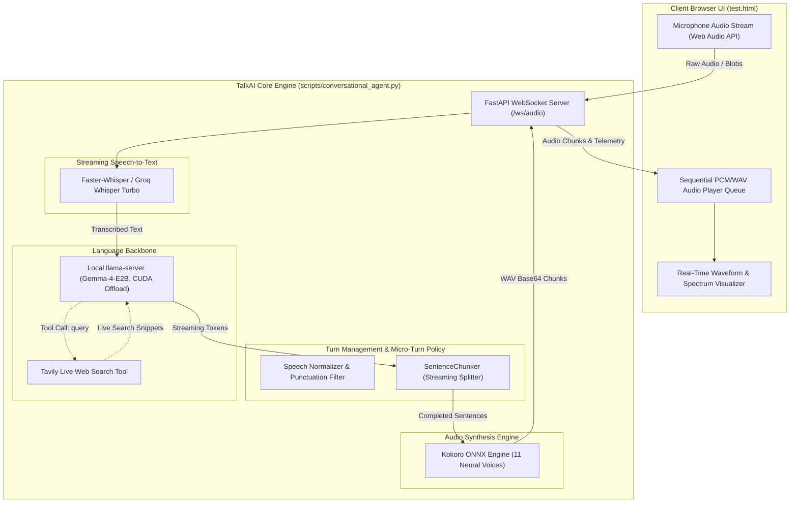

# TalkAI - Local Full-Duplex Conversational Voice Agent

[](https://www.python.org/downloads/)
[](https://fastapi.tiangolo.com)
[](https://huggingface.co/google)
[](https://github.com/thewh1teagle/kokoro-onnx)
[](https://github.com/SYSTRAN/faster-whisper)
[](https://developer.nvidia.com/cuda-zone)

**TalkAI** is an ultra-low-latency, full-duplex conversational voice AI designed for real-time natural dialogue. Running fully locally with GPU acceleration, TalkAI bridges high-performance streaming ASR, local instruction-tuned LLMs (**Gemma-4-E2B** via CUDA-accelerated `llama-server`), and instant neural speech synthesis (**Kokoro-v0_19 ONNX**), achieving micro-turn latencies well below **100 ms**.

---

## Architecture Overview



---

## Key Features

- **Full-Duplex Micro-Turn Streaming**: Low-latency turn execution inspired by [DuplexCascade (arXiv:2603.09180)](https://arxiv.org/abs/2603.09180), supporting natural interjections and turn completion without awkward pauses.
- **Local Gemma-4-E2B Inference**: Full layer offloading (`-ngl 99`) via a dedicated CUDA `llama-server` (`llama-fork`), running with ~2.0 GB VRAM consumption on consumer GPUs.
- **Local Neural Kokoro ONNX TTS**: Blazing-fast speech generation with Real-Time Factor (RTF) < 0.25 on CPU and ONNX Runtime. Provides 11 expressive voices with tunable speeds.
- **Concurrent Sentence-Level Streaming Chunker**: Speech generation begins immediately as the first complete sentence is yielded by the LLM, eliminating time-to-first-audio (TTFA) lag.
- **Integrated Browser Voice Studio**: Single-page modern HTML5/Web Audio UI featuring:
  - Real-time microphone audio visualizer (oscilloscope & frequency bars).
  - Voice selection & playback rate controls.
  - Live execution telemetry: Time-To-First-Token (TTFT), Time-To-First-Audio (TTFA), and Total Turn Elapsed.
  - Tool calling inspection badge for web searches.
- **Real-Time Web Search Tool**: Automated Tavily client integration allows the assistant to search the web for live weather, breaking news, or real-time queries.
- **Offline & Cross-Browser Transcriptions**: Supports both 100% offline local `faster-whisper` and Groq Whisper cloud fallback.

---

## Tech Stack

| Component | Technology | Rationale / Performance |
| :--- | :--- | :--- |
| **LLM Inference** | `Gemma-4-E2B` (GGUF q4_0) | Instruction-tuned, Apache 2.0, running on `llama-server` with CUDA layer offloading |
| **TTS Engine** | `Kokoro-v0_19.onnx` | 82M parameter lightweight diffusion/style TTS; ultra-realistic prosody |
| **ASR Engine** | `Faster-Whisper` / `Groq Whisper Turbo` | Fast local transcription with sub-second turnaround |
| **Server Framework** | `FastAPI` + `WebSockets` | Async event loop, concurrent token/audio streaming |
| **Tool Integration** | `Tavily Search API` | Grounding for live information and web search |
| **Frontend UI** | HTML5 / Vanilla JS / Web Audio API | Zero external frontend build steps; direct WebSocket streaming |

---

## Repository Structure

```
TalkAI---Local/
├── data/
│   ├── archive/
│   │   └── duplexcascade_synthetic_dataset.zip   # Archived synthetic baseline dataset
│   └── duplexcascade_synthetic/
│       ├── micro_turns_train.jsonl               # 390 synthetic micro-turn dialogues
│       ├── micro_turns_val.jsonl                 # 60 zero-leakage validation dialogues
│       ├── micro_turns_test.jsonl                # 60 zero-leakage test dialogues
│       └── README.txt
├── scripts/
│   ├── conversational_agent.py                   # Main FastAPI server, callbacks, Kokoro TTS, & WebSocket loop
│   ├── start_llama_server.sh                     # Launch script for local llama-server with CUDA offload
│   ├── verify_agent.py                           # Comprehensive unit & integration verification suite
│   ├── test.html                                 # Interactive voice browser interface
│   └── dataset_generation/                       # Scripts & prompts for synthetic micro-turn generation
│       ├── generate_train_part1.py
│       ├── generate_train_part2.py
│       ├── generate_train_part3.py
│       ├── generate_val.py
│       ├── generate_test.py
│       └── prompts/
├── .env.example                                  # Template for API keys and configuration
├── .gitignore                                    # Strict exclusions for weights, models, venvs, and secrets
├── plan.md                                       # Architectural specifications and benchmarks
├── requirements.txt                              # Python package dependencies
├── src.txt                                       # Research paper references and foundational links
├── test.html                                     # Root mirror of interactive voice interface
└── transcript.txt                                # Design discussion notes and development logs
```

---

## Getting Started

### 1. Prerequisites

- Linux (Ubuntu 22.04+ recommended) or macOS
- Python 3.10+
- NVIDIA GPU with CUDA support (recommended for `llama-server` GPU offload)
- Built `llama-server` binary (from `llama.cpp` or custom fork)

### 2. Environment Setup

Clone the repository and install dependencies:

```bash
git clone https://github.com/Adityakeerti/TalkAI---Local.git
cd TalkAI---Local

# Create and activate virtual environment
python3 -m venv .venv
source .venv/bin/activate

# Install dependencies
pip install -r requirements.txt
```

### 3. Configure Environment Variables

Copy `.env.example` to `.env` and fill in your keys:

```bash
cp .env.example .env
```

```ini
# Speech-to-Text & Inference (Groq Whisper Turbo)
GROQ_API_KEY=gsk_your_groq_api_key_here

# Real-time Web Search Tool
TAVILY_API_KEY=tvly-your_tavily_api_key_here

# Local llama-server endpoint
LLM_BASE_URL=http://127.0.0.1:8080/v1
LLM_MODEL=gemma-4-E2B
```

### 4. Setup Model Weights

Download the Kokoro ONNX model and voices into `models/kokoro/`:

```bash
mkdir -p models/kokoro
# Place kokoro-v0_19.onnx and voices.bin inside models/kokoro/
# e.g., from https://github.com/thewh1teagle/kokoro-onnx/releases
```

Ensure your Gemma-4-E2B GGUF model files are located in `Gemma-4-E2B/`:
- `gemma-4-E2B_q4_0-it.gguf`
- `gemma-4-E2B-it-mmproj.gguf`

---

## Running TalkAI

### Step 1: Launch Local `llama-server`

Run the GPU offloading script to host Gemma-4-E2B:

```bash
chmod +x scripts/start_llama_server.sh
./scripts/start_llama_server.sh
```

This starts the OpenAI-compatible server at `http://127.0.0.1:8080/v1` with full GPU layer offloading.

### Step 2: Start the Conversational Voice Agent

In a separate terminal:

```bash
python scripts/conversational_agent.py
```

The server will initialize the Kokoro TTS engine and start listening on:
`http://localhost:8000`

### Step 3: Open Browser Interface

Navigate to `http://localhost:8000` (or open `test.html` directly):
1. Click **Connect to Voice Agent**.
2. Select your preferred voice (e.g., *Sarah - Warm & Clear*, *Adam - Deep & Natural*, *Emma - Crisp*).
3. Hold or toggle **Hold to Speak** or type in the test box.
4. Listen to the streaming conversational response synthesized in real time.

---

## Verification & Testing

Execute the test suite to verify text normalization, sentence chunking, Kokoro ONNX synthesis, and agent turn loops:

```bash
python scripts/verify_agent.py
```

Expected output:
```
==================================================
Running TalkAI Comprehensive Verification Suite
==================================================
--> Testing text cleaning & sentence chunking...
    Text cleaning & chunking PASSED.
--> Testing Kokoro TTS Engine...
    Loaded 11 voices.
    Synthesized 2.85s of audio in 142.3ms. PASSED.
--> Testing Conversational Agent turn with LLM callbacks...
    Captured lifecycle events: {'turn_start', 'llm_start', 'token', 'tts_start', 'tts_chunk', 'turn_finish'}
    Conversational turn test PASSED.
--> Testing Tavily search tool callback...
    Tool callback execution PASSED.
==================================================
ALL VERIFICATION CHECKS COMPLETED SUCCESSFULLY!
==================================================
```

---

## Research & Datasets

TalkAI includes a synthetic dialogue dataset (`data/duplexcascade_synthetic/`) created to train and evaluate turn-taking policies in full-duplex conversational systems:
- **`micro_turns_train.jsonl`**: 390 conversational scenarios with micro-turn slices, interjections, and natural interruptions.
- **`micro_turns_val.jsonl`** & **`micro_turns_test.jsonl`**: 60 scenarios each, strictly verified for 0% train/val leakage.
- Generation scripts and prompt definitions are provided under `scripts/dataset_generation/`.

---

## License

This project is licensed under the [Apache License 2.0](LICENSE).
Model weights for Gemma-4-E2B are subject to the [Gemma Terms of Use](https://ai.google.dev/gemma/terms).
Kokoro TTS is provided under the Apache 2.0 license.
